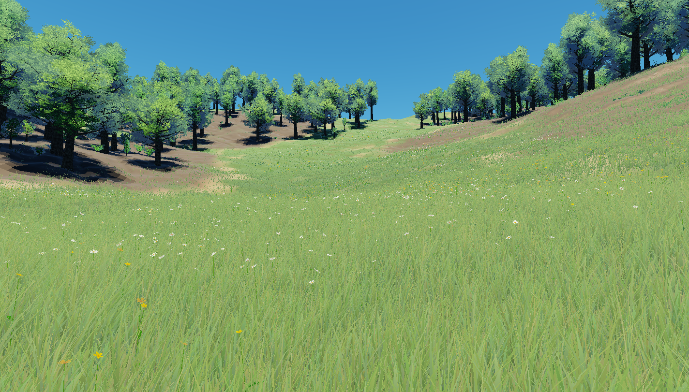

# DuckingEngine

**C++17 · DirectX 12 · HLSL · Windows**

실사 자연환경을 갖춘 액션 게임을 목표로 개발하는 엔진입니다. 행성 규모 대기의 **부동소수점 정밀도와 적분 오차**, 지형 스트리밍의 **메모리·업로드 예산과 비동기 상태 일관성**, 렌더러의 **GPU 진단과 셰이더 교체**를 다룹니다.



*Forest Valley 개발 캡처. 지형, 절차적 잔디·들꽃, 나무 배치를 통합한 장면입니다.*

| 구현 과제 | 설계에서 다룬 문제 | 구현 근거 |
| --- | --- | --- |
| 행성 규모 대기 | 큰 반지름에서 작은 고도를 구할 때의 정밀도 손실, 적분 오차와 계산량 | [수치 안정성을 고려한 기하 계산](Resource/Material/Atmosphere/AtmosphereGeometry.hlsl), [적응형 적분](Resource/Material/Atmosphere/AtmosphereIntegration.hlsl) |
| 지형 스트리밍 | 제한된 GPU 캐시, 카메라 이동 후 도착하는 로딩 결과, LOD·Section 경계 | [비동기 스트리머](TerrainStreaming.cpp), [GPU 캐시 갱신](SceneManager.cpp), [지형 샘플링](Resource/Material/TerrainHeight.hlsl) |
| 렌더러 개발 도구 | 셰이더 교체 도중의 부분 갱신, GPU 내부 오류 추적, 패스별 비용 측정 | [셰이더 교체와 GPU 타임스탬프](RenderModule.cpp), [GPUASSERT 진단](GpuAssertDiagnostics.h) |

## 행성 규모 대기의 수치 안정성

대기는 고도에 따른 밀도와 광선의 경로 길이에 민감합니다. 반지름이 약 6,360 km인 행성에서 `length(position - centre) - radius`를 float로 계산하면, 지표 근처의 작은 고도를 잃을 수 있습니다. 이 크기에서 float32의 인접 값 간격은 **0.5 m**입니다.

카메라 근처에서는 CPU에서 double로 구한 카메라 고도와 카메라 상대 좌표를 사용해 식을 전개합니다. 큰 두 값을 직접 빼는 계산을 줄이고, 구 교차에서도 가까운 두 근의 뺄셈을 피하도록 근의 곱 관계를 사용합니다.

$$
h(\mathbf{x}) = \frac{\mathbf{x}\cdot\mathbf{x} + 2\mathbf{r}_c\cdot\mathbf{x} + h_c(2R+h_c)}{\lVert\mathbf{r}_c+\mathbf{x}\rVert+R}
$$

여기서 $R$은 밀도 기준 반지름, $\mathbf{r}_c$는 행성 중심에서 카메라까지의 벡터, $\mathbf{x}$는 카메라에서 샘플까지의 상대 위치, $h_c$는 CPU에서 구한 카메라 고도입니다. 이 계산은 `atmosphereHeight`에 대응합니다.

<details>
<summary>정밀도 계산 예제</summary>

반지름 6,360,000 m, 카메라 상대 샘플 위치 0에서 두 식의 float32 연산을 CPU로 재현한 결과입니다. 오른쪽 열은 CPU에서 구한 고도를 입력으로 사용하는 현재 셰이더의 식입니다.

| 입력 고도 | float32 반지름 차감 | 현재 셰이더 식 |
| --- | --- | --- |
| 0.01 m | 0 m | 0.00999999978 m |
| 0.1 m | 0 m | 0.100000001 m |
| 1 m | 1 m | 1 m |

</details>

광학 깊이 적분에서는 한 구간의 중점 근사와 분할 근사의 차이에 소멸 계수를 곱해 오차를 추정합니다. 절대·상대 허용 오차를 넘는 구간을 세분화하며, 최대 깊이와 노드 예산으로 계산량을 제한합니다. 허용 오차를 만족하기 전에 예산을 소진하면 결과에 `limitReached`를 남깁니다.

실시간 경로는 투과율·다중 산란 LUT를 재사용합니다. 밀도, 산란 계수, 적분 설정 등 LUT의 의존 값이 바뀌면 관련 결과를 무효화하고 다시 계산합니다. Inspector에는 직접 적분과 비교하는 `Direct reference`, 예산 한계에 도달한 영역을 보는 `Reference limits`, 계산량을 보는 `Production work`를 제공합니다. 직접 적분 비교 영역은 화면 중앙 16 × 16 픽셀입니다.

[고도와 구 교차 계산](Resource/Material/Atmosphere/AtmosphereGeometry.hlsl) · [광학 깊이 적분](Resource/Material/Atmosphere/AtmosphereIntegration.hlsl) · [LUT 조회](Resource/Material/Atmosphere/AtmosphereTransmittance.hlsl) · [LUT 갱신과 진단 UI](SceneRenderer.cpp)

## 고정 예산으로 지형을 스트리밍하는 구조

데모의 지형 데이터는 8,193 × 8,193 높이 샘플을 0.5 m 간격으로 배치한 **4.096 × 4.096 km** 월드입니다. 1.024 km 크기의 Section 16개로 나누고, 카메라 주변 Section의 저해상도 데이터와 근거리 상세 타일을 구분해 관리합니다.


| 제어 대상 | 현재 예산 | 의도 |
| --- | --- | --- |
| Section 저해상도 atlas | 카메라 주변 최대 3 × 3개 | 월드 크기와 상주 Section 수를 분리 |
| 상세 타일 캐시 | 모든 활성 Section이 LOD당 72개 슬롯 공유 | Section마다 캐시를 증설하는 비용 방지 |
| 프레임당 업로드 처리 | Section 최대 2개, 상세 타일 최대 4개 | 완료된 로딩 결과를 여러 프레임에 분산 |

**카메라 이동과 비동기 결과의 일관성.** 요청은 Section ID, LOD, Section 내부 타일 좌표로 식별합니다. 요청 집합이 바뀌면 대기 중인 작업과 완료 큐를 정리하고, GPU 업로드 직전에도 현재 필요한 타일인지 검사합니다. Section atlas는 좌표의 나머지로 슬롯을 재사용하고, 셰이더는 상주 여부와 슬롯에 기록된 실제 Section 좌표를 함께 확인합니다.

**공간 경계와 로딩 경계의 연속성.** Geometry Clipmap은 부모 격자로 정점을 모핑합니다. 높이·법선은 저해상도 데이터에서 상세 타일로 혼합하며, 타일의 로딩 가중치를 계산할 때 인접 Section도 확인합니다. Section 경계의 공유 샘플은 해당 경계를 소유한 상주 Section에서 읽을 수 있습니다. 잔디도 같은 샘플링 경로에서 뿌리 높이와 경사를 구합니다.

현재 렌더링 범위는 상주한 3 × 3 Section입니다. 그 밖의 월드를 표시할 원거리 Proxy와 경계 전환은 후속 구현 범위입니다.

[요청 선택과 작업 스레드](TerrainStreaming.cpp) · [업로드 예산과 페이지 테이블](SceneManager.cpp) · [Section 경계·LOD 샘플링](Resource/Material/TerrainHeight.hlsl) · [Clipmap 모핑](Resource/Material/TerrainClipMap.hlsl) · [잔디 배치](Resource/Material/GrassPatch.hlsl)

## 렌더링을 수정하고 원인을 추적하는 도구

렌더 타깃·패스·파이프라인은 XML로 정의하고, DXC Reflection으로 셰이더 리소스와 상수 버퍼 정보를 수집해 Root Signature와 바인딩을 구성합니다. CPU·HLSL 공용 구조체는 한 헤더에서 정의하고, CPU에서 크기와 주요 오프셋을 컴파일 시 검사합니다.

**셰이더 리로드의 일괄 교체.** Debug의 `reloadShader`는 교체할 파이프라인을 모두 생성한 뒤 GPU 작업 완료를 기다리고 한 번에 적용합니다. 중간 컴파일이 실패하면 기존 파이프라인 집합을 유지합니다. 여러 패스가 서로 다른 리로드 결과를 사용하는 부분 갱신을 방지합니다.

**HLSL 오류 위치와 진단값.** `GPUASSERT`는 atomic 연산으로 최초 실패의 파일 ID, 원본 줄 번호, `uint4` 또는 `float4` 값을 기록합니다. DXC 전처리에서 include 파일 경로를 ID에 연결하고, CPU는 fence 완료 후 readback하여 소스 위치와 값을 출력합니다.

**실제 GPU 실행 구간 측정.** 패스 시작·종료에 GPU 타임스탬프를 기록하고 fence 완료 후 읽습니다. 같은 프레임에 반복 실행한 구간은 합산하며, 실행을 생략한 패스와 최대 시간을 구분해 보여줍니다.


*기존 개발 캡처. LUT 갱신이 생략된 프레임과 실제 실행된 패스를 구분해 확인할 수 있습니다.*

[패스·타깃 정의](Resource/RenderPass/RenderPassGroup.xml) · [DXC Reflection](ShaderCompiler.cpp) · [리로드·타임스탬프·readback](RenderModule.cpp) · [GPUASSERT 셰이더](Resource/Material/Assert.hlsl) · [소스 위치 복원](GpuAssertDiagnostics.h) · [CPU·GPU 공유 데이터](Resource/Material/ShaderStructures.h)

## 해양과 애셋 파이프라인

해양은 초기 주파수 스펙트럼을 시간에 따라 갱신하고, 수평·수직 FFT Butterfly Compute Pass를 거쳐 수면 높이와 법선을 생성하는 구조입니다. 복소수 위상 변화에서 수면 메시까지 GPU 패스로 연결합니다.

[스펙트럼 시간 갱신](Resource/Material/Ocean/SpectrumUpdateCS.hlsl) · [FFT Butterfly](Resource/Material/Ocean/FFTButterflyCS.hlsl) · [수면 렌더링](Resource/Material/Ocean/RenderOcean.hlsl)

Blender 애드온은 Static Mesh, Skinned Mesh, Skeleton, Animation을 엔진 형식으로 내보냅니다. Terrain Cooker는 높이맵을 청크·LOD 아카이브로 변환하고 Section 단위 파일로 분할합니다.

[Blender Exporter](DKBlenderAddnos/README.md) · [Terrain Cooker](Tools/TerrainCooker/README.md)

<details>
<summary>초기 대기·해양 구현 캡처</summary>


</details>

## 기술 문서

대기의 빛 전달, Rayleigh·Mie 산란, ray marching과 실시간 계산 구조를 정리한 자료입니다.

[대기 렌더링 노트 PPT](output/Atmosphere_Rendering_Notes_Consistent.pptx)

## 빌드 및 실행

<details>
<summary>개발 환경과 빌드</summary>

Visual Studio 2022의 **C++를 사용한 데스크톱 개발** 워크로드와 Windows SDK가 필요합니다. 렌더러는 DirectX 12를 사용합니다. [DXC 릴리스](https://github.com/microsoft/DirectXShaderCompiler/releases/tag/v1.10.2605.37)의 `dxc_2026_08_11.zip`에서 `bin/x64/dxcompiler.dll`과 `bin/x64/dxil.dll`을 추출해 `lib/dxc_2026_08_11/bin/x64/`에 둡니다.

저장소 루트에서 Visual Studio Developer PowerShell로 빌드합니다. `/restore`는 NuGet의 DirectX 12 Agility SDK를 복원합니다.

```powershell
msbuild .\DuckingEngine_v0002.sln /restore /p:RestorePackagesConfig=true /p:Configuration=Debug /p:Platform=x64
msbuild .\Tools\TerrainCooker\TerrainCooker.vcxproj /p:Configuration=Release /p:Platform=x64 /p:OutDir=../../Platform/Tools/TerrainCooker/ /p:IntDir=../../Platform/Tools/TerrainCooker/Intermediate/
```

</details>

<details>
<summary>Forest Valley 지형 생성과 실행</summary>

현재 레벨은 `Scenes/PracticeTerrain/Cooked/Sections_2048/terrain.xml`을 참조합니다. Cooked 데이터는 Git에서 제외하므로 저장소에 포함된 높이맵으로 생성합니다. `--split`의 출력 폴더는 아직 존재하지 않아야 합니다.

```powershell
$cooker = '.\Platform\Tools\TerrainCooker\TerrainCooker.exe'
$cooked = '.\Resource\Scenes\PracticeTerrain\Cooked'
New-Item -ItemType Directory -Path $cooked -Force | Out-Null
& $cooker .\Resource\Scenes\textures\forest_valley_extended_height_8k.png "$cooked\forest_valley_extended.dkterrain" 0.5 -16 128 128
& $cooker --split "$cooked\forest_valley_extended.dkterrain" "$cooked\Sections_2048" 2048
.\Platform\x64\Debug\Binaries\DuckginEngine_v0002.exe --resourcePath=Resource --level=Scenes/ForestValley.xml
```

실행 후 `Inspector`에서 대기·조명·이미지 설정을 조절합니다. `Surface`와 `Orbit`으로 카메라를 전환하고, `F1`으로 UI를 숨기거나 표시할 수 있습니다. 대기 직접 적분 비교와 GPU 진단은 Debug 구성에서 확인합니다.

</details>
